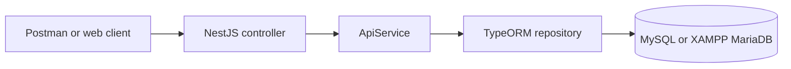

# EduTrack Project Documentation

**Genesis L. Narito | BSIT 4-A | ITEC 116**

[Submission PDF](EduTrack_Documentation.pdf) ? [Entity relationship diagram](ERD.md) ? [Local setup](../README.md)

## Overview

EduTrack is a NestJS REST API for monitoring student attendance and grades. Administrators maintain profiles, courses, enrollments, and accounts. Teachers record attendance and grades for their assigned courses. Students can view their own enrollments and performance report.

## Architecture



For a student creation request, DTO validation checks the JSON body, the controller checks administrator access, and the service saves the student via TypeORM. The API returns the new record and its generated student ID with HTTP 201.

## Database

The [SQL setup script](../database/edutrack.sql) defines students, teachers, courses, enrollments, attendance, grades, and accounts. Enrollment links a student to a course. Attendance and grades use that enrollment ID rather than duplicating the student/course pair in both tables. Each enrollment has at most one attendance record per date. The grade record also identifies the recording teacher.

## Authentication and access

Accounts store salted Argon2id password hashes. Login returns a signed HS256 JWT that expires after 15 minutes. Send it as `Authorization: Bearer <token>`. Missing or invalid tokens return 401; insufficient permission returns 403. Login attempts are rate-limited locally per IP. Administrators handle roster and account changes. Teachers write attendance and grades for assigned courses; administrators can read these records. Students use their own report route.

## REST endpoints

Prefix all routes below with `/api/v1`. List endpoints support `page` and `limit`; attendance and grade lists also accept `enrollmentId`.

| Method | Route | Success |
| --- | --- | --- |
| POST | `/auth/login` | 200 |
| GET | `/auth/profile` | 200 |
| POST | `/auth/accounts` | 201 |
| GET | `/students` | 200 |
| GET | `/students/:id` | 200 |
| POST | `/students` | 201 |
| PATCH | `/students/:id` | 200 |
| DELETE | `/students/:id` | 204 |
| PUT | `/students/:id` | 200 |
| GET | `/students/:id/enrollments` | 200 |
| GET | `/students/:id/report` | 200 |
| GET | `/teachers` | 200 |
| GET | `/teachers/:id` | 200 |
| POST | `/teachers` | 201 |
| PATCH | `/teachers/:id` | 200 |
| DELETE | `/teachers/:id` | 204 |
| GET | `/courses` | 200 |
| GET | `/courses/:id` | 200 |
| POST | `/courses` | 201 |
| PATCH | `/courses/:id` | 200 |
| DELETE | `/courses/:id` | 204 |
| GET | `/enrollments` | 200 |
| GET | `/enrollments/:id` | 200 |
| POST | `/enrollments` | 201 |
| PATCH | `/enrollments/:id` | 200 |
| DELETE | `/enrollments/:id` | 204 |
| GET | `/attendances` | 200 |
| GET | `/attendances/:id` | 200 |
| POST | `/attendances` | 201 |
| PATCH | `/attendances/:id` | 200 |
| DELETE | `/attendances/:id` | 204 |
| GET | `/grades` | 200 |
| GET | `/grades/:id` | 200 |
| POST | `/grades` | 201 |
| PATCH | `/grades/:id` | 200 |
| DELETE | `/grades/:id` | 204 |

### Example: create a student

As an administrator, send `POST /api/v1/students` with:

```json
{
  "firstName": "Ana",
  "lastName": "Reyes",
  "email": "ana@example.test",
  "yearLevel": 4
}
```

The response contains the submitted fields and the generated `studentId`. Invalid input returns 400, missing records return 404, and duplicate or referenced-record conflicts return 409.

## Testing and demo

Import the [Postman collection](../postman/EduTrack.postman_collection.json). The XAMPP verification used MariaDB 10.4.32 and ran six collection requests via Newman: login, student create/read/update/delete, and a protected request without a token. All six assertions passed. This was a demo subset, not a run of every route.

For the narrated recording, start the application, log in, run the student CRUD sequence in Postman, trace the request from controller to database, show a 401 without a token, and verify the result in the database.

## Current limits

The local prototype binds to loopback. HTTPS deployment and email notifications are not configured. The narrated demonstration link is pending.
