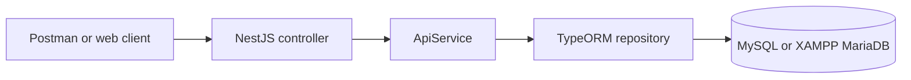

# EduTrack: Student Attendance and Academic Performance Monitoring API

**Genesis L. Narito | BSIT 4-A | ITEC 116**

[Submission PDF](EduTrack_Documentation.pdf) | [Local setup](../README.md)

## Table of contents

1. [Project Overview](#1-project-overview)
2. [System Analysis](#2-system-analysis)
3. [System Architecture](#3-system-architecture)
4. [Database Design](#4-database-design)
5. [REST API Design](#5-rest-api-design)
6. [Authentication and Security](#6-authentication-and-security)
7. [Backend Implementation](#7-backend-implementation)
8. [API Testing and Validation](#8-api-testing-and-validation)
9. [Conclusion](#9-conclusion)
10. [References](#10-references)
11. [Appendix](#11-appendix)


## 1. Project Overview

### 1.1 System purpose

EduTrack centralizes student attendance, enrollments, and grades in a REST API.

### 1.2 Intended users

- **Administrators** maintain profiles, courses, enrollments, and accounts.
- **Teachers** record attendance and grades for their assigned courses.
- **Students** view their own enrollments and performance.

### 1.3 Objectives

Reduce duplicate records, protect student information, and make attendance and grade records easy to retrieve by enrollment.

### 1.4 Major features

JWT login, role-based access, six CRUD resources, attendance and grade tracking, and a student performance report.

## 2. System Analysis

### 2.1 Problem statement

Separate attendance sheets and grade files make it difficult to reconcile records or follow a student's progress across courses.

### 2.2 Proposed solution

Use enrollment as the link between students and courses, then store attendance and grades against that enrollment. A versioned API gives each role access to the operations it needs.

### 2.3 Scope and limitations

This is a backend prototype. It has no web frontend or email delivery. The local server uses loopback HTTP; HTTPS hosting has not been configured.

## 3. System Architecture



### 3.1 Layer responsibilities

| Layer | Responsibility |
| --- | --- |
| Client | Sends HTTP requests and reads JSON responses. |
| Controller | Maps routes and invokes authentication and permission checks. |
| DTO and validation pipe | Reject invalid values and unexpected fields. |
| ApiService | Applies access rules and coordinates database operations. |
| TypeORM and database | Map records to tables and enforce relational constraints. |

### 3.2 Example request flow

An administrator sends a student record from Postman. NestJS validates the DTO; the controller checks the caller's role, then the service saves through TypeORM. The database generates the student ID, and the API responds with HTTP 201.

## 4. Database Design

### 4.1 ERD

See the [rendered entity relationship diagram](ERD.md) and [SQL schema](../database/edutrack.sql).

### 4.2 Relationship explanation

A teacher can teach multiple courses. Students join courses through enrollments. Each enrollment can have multiple attendance and grade records. Each grade identifies the recording teacher. Student and teacher accounts link to the corresponding profile.

### 4.3 Normalization

Attendance and grades reference the enrollment instead of repeating the student/course pair. The schema enforces one enrollment per student/course pair and one attendance entry per enrollment/date.

## 5. REST API Design

All routes below use the prefix `/api/v1`.

### 5.1 Authentication endpoints

| Method | Route | Access | Success |
| --- | --- | --- | --- |
| POST | `/auth/login` | Public | 200 |
| GET | `/auth/profile` | Authenticated | 200 |
| POST | `/auth/accounts` | Administrator | 201 |

### 5.2 CRUD endpoints

| Resource | List | Detail | Create | Update | Delete |
| --- | --- | --- | --- | --- | --- |
| Students | GET `/students` | GET `/students/:id` | POST `/students` | PATCH `/students/:id` | DELETE `/students/:id` |
| Teachers | GET `/teachers` | GET `/teachers/:id` | POST `/teachers` | PATCH `/teachers/:id` | DELETE `/teachers/:id` |
| Courses | GET `/courses` | GET `/courses/:id` | POST `/courses` | PATCH `/courses/:id` | DELETE `/courses/:id` |
| Enrollments | GET `/enrollments` | GET `/enrollments/:id` | POST `/enrollments` | PATCH `/enrollments/:id` | DELETE `/enrollments/:id` |
| Attendances | GET `/attendances` | GET `/attendances/:id` | POST `/attendances` | PATCH `/attendances/:id` | DELETE `/attendances/:id` |
| Grades | GET `/grades` | GET `/grades/:id` | POST `/grades` | PATCH `/grades/:id` | DELETE `/grades/:id` |

Additional routes: `PUT /students/:id` replaces a student record; `GET /students/:id/enrollments` lists their enrollments; `GET /students/:id/report` returns attendance and grades to the administrator or the student who owns the record. Together these make **36 endpoints**.

List routes support `page` and `limit`; attendance and grade lists also support `enrollmentId`. CRUD reads and updates return 200, creates return 201, and deletes return 204.

### 5.3 Request and response examples

As an administrator, send `POST /api/v1/students`:

```json
{
  "firstName": "Ana",
  "lastName": "Reyes",
  "email": "ana@example.test",
  "yearLevel": 4
}
```

A successful request returns 201 and the submitted fields plus `studentId`. Invalid input returns 400; missing records return 404; duplicate or referenced-record conflicts return 409.

## 6. Authentication and Security

Passwords use salted Argon2id. Login returns an HS256 JWT valid for 15 minutes; send it as `Authorization: Bearer <token>`. Invalid or missing tokens return 401, and insufficient permissions return 403. Login is rate-limited per IP. The API checks a teacher's course assignment before accepting attendance or grade writes.

## 7. Backend Implementation

[Source](../src/main.ts) contains the NestJS controllers, DTOs, TypeORM entity schemas, and shared service. Schema synchronization is disabled; initialize the database with the SQL script. Load credentials and JWT settings from a local, untracked `.env`.

## 8. API Testing and Validation

### 8.1 Recommended demo order

Start the server, log in, create/read/update/delete a disposable student, trace one request through the code, show 401 without a token, then verify the deletion in the database.

### 8.2 Validation checks

Six requests from the [Postman collection](../postman/EduTrack.postman_collection.json) passed via Newman against XAMPP MariaDB 10.4.32: login, student CRUD, and the missing-token check. Separate HTTP checks confirmed 400 for an invalid year level and 404 after deletion. This is not a full endpoint regression suite.

### 8.3 Data-flow explanation for presentation

Show `StudentsController`, the save method in `ApiService`, the students entity schema and TypeORM repository call, then the corresponding database table and HTTP response.

## 9. Conclusion

EduTrack implements the attendance and grade workflows proposed in Labs 03?06 and demonstrates an authenticated CRUD sequence against XAMPP.

## 10. References

- Genesis L. Narito, *Laboratory Activities 03?06: EduTrack*.
- [NestJS documentation](https://docs.nestjs.com/)
- [TypeORM documentation](https://typeorm.io/)
- [RFC 7519: JSON Web Token](https://www.rfc-editor.org/rfc/rfc7519)

## 11. Appendix

### A. Deliverable checklist

- [x] GitHub source code
- [x] Technical documentation PDF
- [x] SQL and Postman files
- [ ] Narrated demo recording and shareable link

### B. Future improvements

Add email delivery, deploy behind HTTPS, and expand automated coverage to role permissions and attendance/grade workflows.
